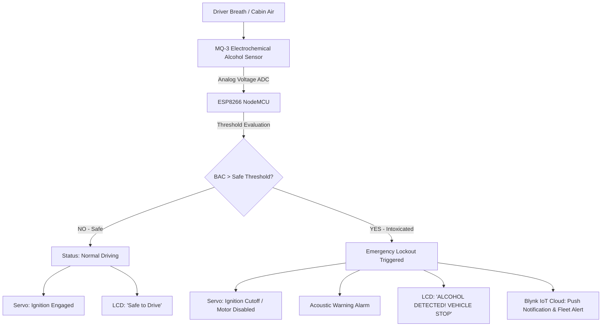

# Drunk Driver Detection IoT System: Automotive Alcohol Interlock with Blynk IoT Telemetry & Automatic Ignition Lockout

[](https://www.espressif.com/)
[]()
[](https://blynk.io/)
[]()
[](https://opensource.org/licenses/MIT)

> **Automotive Embedded Safety Project | Graphic Era Hill University (B.Tech ECE 2023–2027)**  
> **Author:** Parth Dalakoti (*President, Robotics & Automation Club, GEHU*)  
> **Contact:** `parthdalakoti482@gmail.com` | [LinkedIn](https://linkedin.com/in/parthdalakoti)

---

## ⚡ Executive Summary

This automotive embedded system implements an intelligent **Alcohol Ignition Interlock Device (IID)** designed to eliminate drunk driving accidents:
1. **Ethanol Vapor Sensing:** Utilizes an **MQ-3 electrochemical gas sensor** to measure blood alcohol concentration (BAC) from cabin air / driver breath.
2. **Servo Motor Ignition Lockout:** Automatically disconnects vehicle starter ignition (modeled via high-torque servo mechanism and ignition cut-off relay) when alcohol threshold exceeds calibrated limits.
3. **Blynk IoT Telemetry & Alerting:** Streams real-time PPM levels to a remote fleet dashboard over Wi-Fi, generating push notifications and triggering on-board acoustic buzzer alarms and 16x2 I2C LCD warnings.

---

## ⚙️ Architecture & Logic Flow



---

## 🛠️ Bill of Materials (BOM)

| Component | Part / Spec | Voltage | Interface | Role |
| :--- | :--- | :--- | :--- | :--- |
| **Microcontroller** | ESP8266 NodeMCU (ESP-12E) | 3.3V Logic / 5V USB | Wi-Fi 802.11 b/g/n, ADC, I2C | Sensor sampling & cloud telemetry |
| **Alcohol Sensor** | MQ-3 Gas Sensor (SnO2 substrate) | 5V | Analog Output (A0) | Ethanol vapor detection (0.05 - 10 mg/L) |
| **Ignition Actuator** | SG90 / MG996R Servo Motor | 5V | PWM (50 Hz) | Mechanical starter ignition disengagement |
| **Display** | 16x2 Character LCD + PCF8574 I2C | 5V | I2C (Address 0x27) | Real-time BAC & vehicle status output |
| **Acoustic Alert** | 5V Active Piezo Buzzer | 5V | Digital Output | Immediate driver cabin audible alarm |

---

## 🔌 Hardware Pinout Table

| ESP8266 Pin | Peripheral Connection | Function |
| :--- | :--- | :--- |
| **A0** | MQ-3 Analog Out | 10-bit Analog to Digital Converter (ADC) |
| **D1 (GPIO 5)** | LCD SCL | I2C Clock Line |
| **D2 (GPIO 4)** | LCD SDA | I2C Data Line |
| **D5 (GPIO 14)**| SG90 Servo Signal | PWM Ignition Lockout Servo Control |
| **D6 (GPIO 12)**| Piezo Buzzer (+) | Acoustic Alarm Output |

---

## 🚀 Firmware Setup

1. Open [`firmware/drunk_driver_detection_esp8266.ino`](firmware/drunk_driver_detection_esp8266.ino).
2. Set your Blynk Template credentials:
   ```cpp
   #define BLYNK_TEMPLATE_ID   "TMPL3cbM5tvh5"
   #define BLYNK_TEMPLATE_NAME "DRUNK DRIVE DETECTION SYSTEM"
   #define BLYNK_AUTH_TOKEN    "YOUR_BLYNK_TOKEN"
   ```
3. Flash to NodeMCU via Arduino IDE or PlatformIO.

---

## 👨‍💻 Engineering Author
**Parth Dalakoti**  
*B.Tech in Electronics & Communication Engineering (2023–2027)*  
*Graphic Era Hill University (GEHU), Bhimtal Campus*  
*President, Robotics & Automation Club, GEHU*
